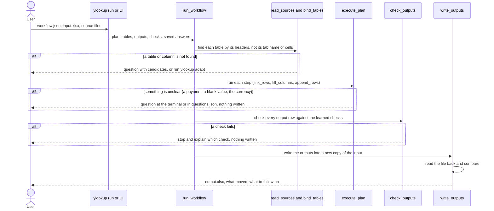
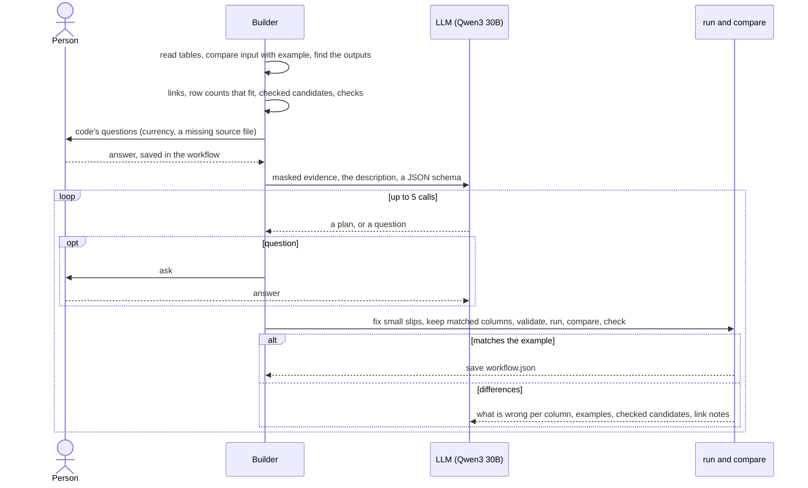
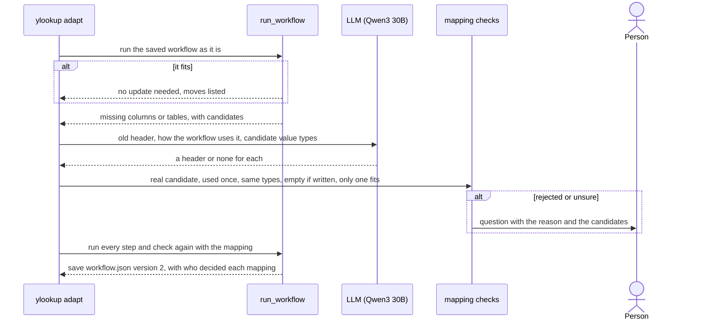

# Design

The brief evaluates the builder, not this one spreadsheet. So the code holds only general tools and checks.
Everything about the job is learned from the files and the description, and stored in `workflow.json`.
There is no bank-statement code: a PDF is just another file of tables.

| What the builder needs to know | Where it comes from |
|---|---|
| Which file is the input, the example, a source | The example is the workbook that adds rows or fills columns compared with another |
| The tables in each file | Workbook header rows; PDF header lines followed by dated rows |
| Which table's text names another table's records | Text columns that match names, in full or by first name and surname prefix |
| What the job produces | The difference between the input and the example |
| What each row iterates over | Row counts that fit (10 investors × 2 lines = 20 rows) |
| What each output column means | Expressions code checks against every example row |
| The steps, their order, the matching rule | The model, from the evidence and the description |
| Checks for later runs | Patterns every example row follows (debit flags, counters, totals, lookups, signs) |
| Where things are in a new input | Header fingerprints saved at build time |
| Policies, such as currency | A person's recorded answer |

## How a saved workflow produces the output

No model is used here. Phase 2 is only this. Phase 3 runs it first.

## How a workflow is built (Phase 1)

## How a workflow adapts to a changed input (Phase 3)

## What's in `workflow.json`

| Key | Meaning |
|---|---|
| `plan` | The intent and the steps. Each step is a tool with an intent and one expression per output column. |
| `tables` | Each table the plan uses: build-time sheet name, header fingerprint, column types |
| `outputs` | What the job produces: rows added to a table, or columns filled in it |
| `checks` | Patterns learned from the example: required or blank per line, constants, counters, totals, lookups, signs |
| `answers` | Policy answers a person gave |
| `workflow_version`, `adaptations` | Version, and each adapt's column mappings with who decided them |

It stores no cell addresses and no copies of answer rows.

## Main design decisions

| Decision | Alternatives | Why |
|---|---|---|
| Qwen3-30B-A3B-Instruct | Mistral Small 3.2 24B | Under 35B, open weights, reliable JSON output, cheap (about $0.002 per build). Mistral did not finish a full build in my early tests. |
| Every file is tables, links are learned | A bank-statement parser and a "match deposits" step | Customers have different sources. Matching is a general link between a text column and a name column. |
| File roles from content | Fixed upload slots | Files can come in any order and with any names. |
| Outputs learned by comparing input and example | A hand-written output schema | Works for any template. Tests use a different one. |
| Code proposes checked candidates, the model composes | The model reads raw rows; or code writes the whole plan | A 30B model is weak at searching 26 columns × 20 rows but good at choosing. Code's search is exact. |
| A small plan language run by code | The model writes Python or fills cells | A plan can be validated, replayed and adapted. |
| No model at run time | An agent solves each run again | Repeatable, free, no drift. |
| Tables found by header fingerprint | Fixed tabs and cells; alias lists | Renamed tabs and moved columns need nothing. A renamed header can't pull in the wrong table. |
| Checks learned from the example | Hand-written accounting rules | They come from evidence and work for any job. |
| Questions with stable ids | Only a currency question; a pre-written answers file | Any step can ask. Policy answers are saved in the workflow. |
| Fix small model slips, reject the rest with reasons | Reject everything | A small model often wraps or pastes things slightly wrong. The fixes keep the meaning. |
| When the model repeats a mistake, code uses the only checked candidate | Keep asking the model | Saves calls. Logged as `adopted_candidates`. |
| Keep columns that already match | Let the model rewrite everything | The model used to break correct columns while fixing others. |
| Adapt: model proposes, code checks, a person settles ties | Model alone; fuzzy name matching | Code rejects wrong types and reused columns. Two empty columns that fit go to a person. |
| Ask for a missing source file before any model call | Let the model search for values no file holds | It could only guess. |
| Link evidence goes back to the model before a person | Ask the person whenever the model asks | If the plan's matching rule linked fewer rows than another rule would, the model is told, along with the columns that broke. It asks people only about the business. |
| Ask when a number has a sign the example never showed | Post it; a "small gap" threshold | A question costs a click. A silent wrong post costs more. |
| Rows a person leaves unlinked skip link checks and are listed | Stop on every unlinked row | The customer leaves unmatched payments to chase later. |
| Numbers in the description become candidates | Parse rules from English; let the model invent formulas | "Tax is 20% of gross" gives `gross × 0.2`, kept only if it matches every example row. |
| Candidates for every iteration that fits | Candidates for the first fit only | The model may choose the other fit. It then gets the candidates for its own choice. |
| Mask private values | Send raw data | Names, the fund, bank references and dates become tokens. |
| CLI plus a chat UI | Forms; a notebook | Questions come back as chat messages, and the trace streams live. |

## Assumptions

- EUR statement amounts are posted as USD with no FX conversion, as the example does. This is a person's saved answer, not code.
- Each table has one header row and ends at the first blank row. Units rows (like `USD`) can sit under the header.
- The record key is the first column with distinct text (an ID or a name).
- Output tables start empty in the input, and filled columns start blank.
- A PDF has a text layer. Its table has a header line and rows that start with a date, and ends at a blank line.
- PDF dates are `12 Mar 2026`, `2026-03-12`, `12/03/2026` (day first) or similar. Amounts look like `1,234.56`. Anything else becomes a question.
- The currency question needs a currency label on both sides. Without one, amounts are posted as they are.
- The input was saved by Excel, so formula results are cached.
- One example shows every convention the job relies on.

## Known limitations

- Checks and sign ranges come from one example, so a coincidence can look like a rule. That can stop a run; it can't write a wrong value.
- Candidate search covers single values, lookups, a prefix or suffix, one add or subtract, and a value times a number from the description. Longer formulas are left to the model.
- On two similar columns, adapt often asks instead of mapping.
- Partial-name matching is first name plus a surname prefix. "Daniel Brown" would match "DANIEL BRO". A unique full-name match always wins.
- PDFs need a text layer. Scans need OCR first.
- No formula recalculation: an input saved without cached results asks for each blank value.
- Tables of 50 rows or fewer are treated as private. That cutoff is a heuristic.

## With more time

1. A benchmark of many workflows and stress variants, to score every prompt or code change.
2. Several completed examples per build, to tell rules from coincidences.
3. Formula recalculation, for example with LibreOffice.
4. Longer formulas in the candidate search, such as rates taken from a table.
