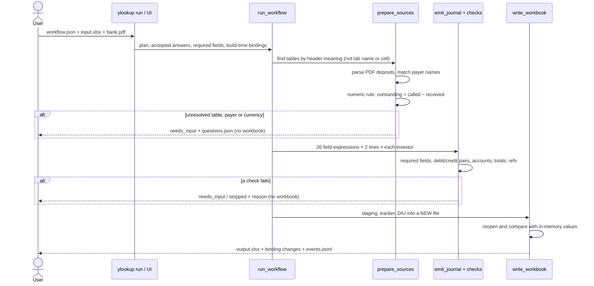
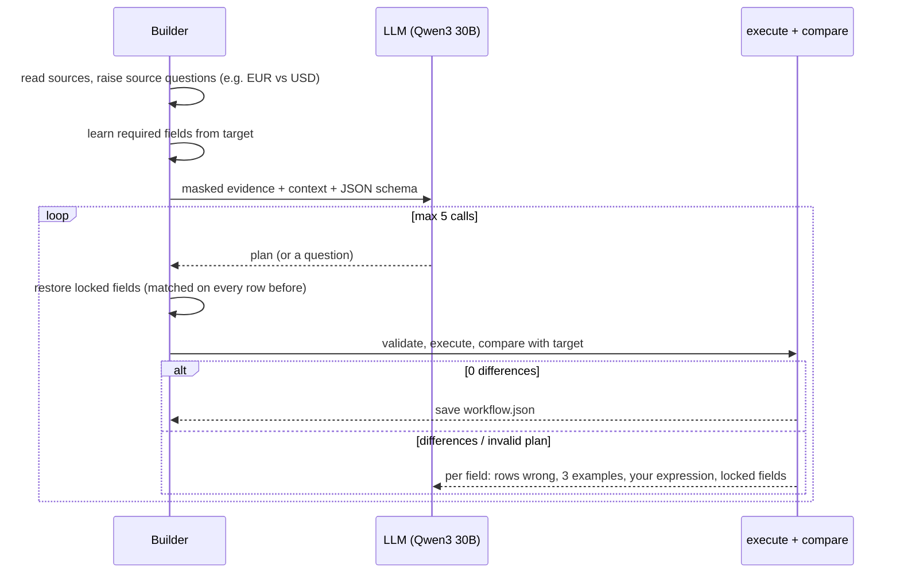
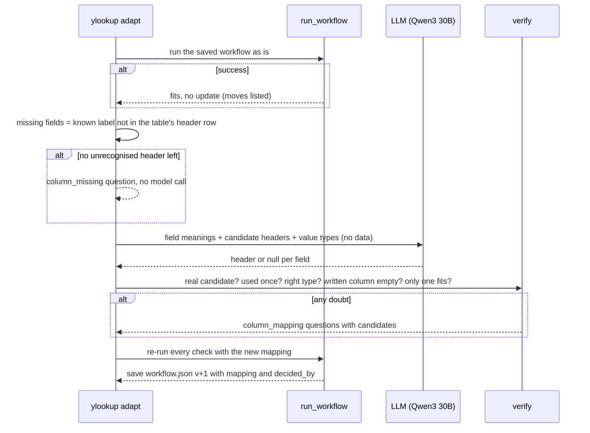

# Design

## How a saved workflow produces the output

There is no model in this path. Phase 2 runs only this; Phase 3 runs it first.

## How the workflow is built (Phase 1)

## How a workflow adapts to a changed input (Phase 3)

## What's in `workflow.json`

| Key | Meaning |
|---|---|
| `plan.steps` | Ordered operations, each with an intent |
| `plan.numeric_rule` | e.g. `outstanding = called − received` |
| `plan.matching_policy` | `full_name_only` or `full_or_unique_prefix` |
| `plan.journal.fields` | One expression per DIU header: source field, literal, per-line choice, concatenation or account lookup |
| `accepted_answers` | User decisions (e.g. the currency policy) |
| `checks.required_fields` | DIU fields the target always fills, per line; learned at build time |
| `bindings` | Where each table was found at build time; used to report moves |
| `headers` | Header label seen for each source field; adapt extends it |
| `workflow_version`, `adaptations` | Version, plus each adapt's mapping (from, to, `decided_by`) |

It stores no cell addresses and no answer rows.

## Main design decisions

| Decision | Alternatives considered | Why |
|---|---|---|
| The model writes a small JSON plan; code executes it | Model writes Python or Excel formulas; model fills cells directly | A model under 35B is unreliable at arithmetic and long outputs. A plan can be validated, replayed and diffed. |
| No model at run time | An agent re-solves each run | Reproducible, free, no drift. The workflow is the contract. |
| Find tables by header meaning | Fixed tab and cell addresses; model mapping on every run | Survives renamed tabs and reordered columns without a model call. |
| Compare business values, not formulas | Clone the target's formulas and helper columns | The accounting upload consumes values. |
| Code detects ambiguity and asks | Let the model decide when to ask | The small model asked bogus questions. Conflicts such as EUR vs USD, duplicate payers or missing columns are detected deterministically. |
| Required fields learned from the target | Hand-written per-field rules | Generic. Stops blank uploads instead of writing them. |
| Strict JSON schema plus local validation | Free text; tool calling | The schema shapes the output, and local checks catch what it can't (e.g. wrong amounts). |
| Lock fields that already match | Let the model rewrite the whole plan each call | The model used to break correct fields while fixing others. |
| Adapt: model proposes, code verifies | Model decides alone; fuzzy string match | Code catches a wrong-type or reused pick. A column the workflow writes must be empty, and a tie between empty columns goes to a person: a live run once mapped onto a column that held data. |
| Qwen3-30B-A3B | Mistral Small 3.2 24B | Mistral did not pass a full build in testing. |
| Mask names, dates and codes before sending | Send raw data | Privacy by default. Cost: longer prompt rules. |
| CLI + Streamlit | Web app; notebook | Least code for file picking, tables and downloads, and it reuses the CLI functions. |

## Assumptions

- EUR receipts are posted as USD amounts without FX, as the target does. This is an explicit, recorded answer.
- Non-payers get zero-value journal pairs, as in the target.
- Short payments (5 and 20) remain outstanding. They are not treated as fees.
- One receipt per investor. Repeated payments and withdrawals stop for review.
- The bank PDF has a text layer with Date / Description / Withdrawal / Deposit / Balance columns.
- The input was saved by Excel, so formula results are cached.
- The fund-constants table has a single row.
- DIU headers are fixed: the upload template is strict.

## Known limitations

- **Build reliability:** the model succeeds in 4 of 5 live builds on the current prompt (v13), usually needing all 5 calls; across all rounds since R05 the rate is 13 of 20 (it was 1 of 18 before). The remaining failure left one field wrong on every row (Batch Index). A failed build saves nothing.
- **Adapt handles renamed or moved columns only.** A removed column, or a new kind of table, stops and asks.
- `learned_headers` changes module-level alias sets during a run, so it is not thread-safe.
- **No formula recalculation.** An input saved without cached results stops.
- **Questions:** only the currency answer type is supported. The CLI stops rather than prompting; the UI prompts.
- Journal pair rules (`Is Debit` Yes/No, `Trans Index` 1/2) are written for this double-entry template.

## With more time

1. Raise build reliability: a larger model, or more calls with smarter feedback.
2. A benchmark of several workflows and stress variants, reporting the success rate per change.
3. Formula recalculation, e.g. LibreOffice headless.
