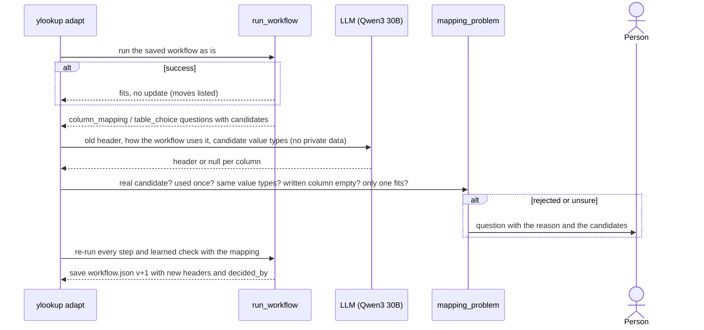

# Design

The criterion is the builder, not this spreadsheet. Code holds only general tools and checks; what
the job is (which file is which, output tables and headers, which columns mean what, how tables
link, the steps, the conventions) is learned from the files and the customer's description, and
stored in `workflow.json`. There is no bank-statement tool: a PDF is just another file of tables.

| Knowledge | Where it comes from |
|---|---|
| Which file is the input, the completed example, a source | Content: the example is the workbook that adds rows or fills columns compared with another (`guess_roles`) |
| The tables in every file | Workbook header rows (`find_tables`); PDF header lines followed by dated rows (`pdf_tables`) |
| Which table's text names another table's records | Rows each text column links uniquely, by full or partial name (`link_evidence`) |
| Output tables, their headers, which columns get filled | Diff of the input against the target (`learn_outputs`) |
| Rows per entry and what an entry iterates over | Row counts that fit (`fits`: e.g. 10 records × 2 lines) |
| What each output column means | Candidate expressions verified against every target row (`explain`) |
| The steps and their order | The model, from the tool catalogue and the evidence |
| Which link to use, its matching policy, which rows to include | The model, from the customer's description and the link evidence |
| Run-time checks (debit flags, counters, balances, lookups) | Conventions every target row follows (`learn_checks`, `survey`) |
| Where tables and columns are in a new input | Header fingerprints saved at build time |
| Policies (e.g. currency) | A person's recorded answers |

## How a saved workflow produces the output

There is no model in this path. Phase 2 runs only this; Phase 3 runs it first.

```mermaid
sequenceDiagram
    actor User
    participant CLI as ylookup run / UI
    participant Runner as run_workflow
    participant Sources as read_sources + bind_tables
    participant Plan as execute_plan
    participant Checks as check_outputs
    participant Writer as write_outputs

    User->>CLI: workflow.json + input.xlsx + any source files
    CLI->>Runner: plan, tables, outputs, checks, recorded answers
    Runner->>Sources: find each table by its header fingerprint (not tab name or cell)
    alt a table or header is not found
        Sources-->>User: question with candidates (or run ylookup adapt)
    end
    Runner->>Plan: each step: link_rows, fill_columns, append_rows
    Plan->>Plan: expressions per column and line; doubt becomes a question
    alt unanswered question (unmatched payment, blank value, currency)
        Plan-->>User: asks at the terminal, or questions.json; no workbook
    end
    Runner->>Checks: learned conventions on every output row
    alt a check fails
        Checks-->>User: stopped + the convention broken; no workbook
    end
    Runner->>Writer: outputs into a NEW file (output tables must start empty)
    Writer->>Writer: reopen and compare with in-memory values
    Writer-->>User: output.xlsx + layout changes + events.jsonl
```

## How the workflow is built (Phase 1)

```mermaid
sequenceDiagram
    actor Person
    participant Builder
    participant Model as LLM (Qwen3 30B)
    participant Code as execute + compare

    Builder->>Builder: find tables; diff input vs target -> outputs
    Builder->>Builder: name-matching evidence, fits, candidate expressions, checks
    Builder->>Person: code's questions (e.g. EUR statement table vs USD tracker)
    Person-->>Builder: answer (recorded in the workflow)
    Builder->>Model: masked evidence + customer description + JSON schema
    loop max 5 calls
        Model-->>Builder: plan, or a question
        opt question
            Builder->>Person: ask
            Person-->>Model: answer
        end
        Builder->>Code: repair common slips, restore locked columns, validate, run, compare, check
        alt matches the target
            Code-->>Builder: save workflow.json
        else differences
            Code-->>Model: per column and line: rows wrong, examples, your expression, verified candidates
        end
    end
```

## How a workflow adapts to a changed input (Phase 3)



## What's in `workflow.json` (schema 3)

| Key | Meaning |
|---|---|
| `plan.intent`, `plan.steps` | The steps, each a tool (`link_rows`, `fill_columns`, `append_rows`) with an intent |
| `plan.steps[].columns` | One expression per output column: a column (of the record, its linked record or a one-row table), a sum or value over linked rows, a counter, a unit, a lookup, a concatenation, arithmetic, a per-line choice or a literal |
| `tables` | Each table the plan uses: build-time sheet, header fingerprint, and per column its header, value types and position |
| `outputs` | What the job produces: rows appended to a table, or columns filled in its records |
| `checks` | Conventions learned from the target: required/blank per line, constant template values, one value per line, equal across an entry, counters, totals that tie to linked rows, lookups and relations, and the sign each number kept (outside it, a person is asked) |
| `answers` | Policy answers a person gave (id, question, answer) |
| `workflow_version`, `adaptations` | Version, and each adapt's mapping (from, to, `decided_by`) |

It stores no cell addresses and no answer rows.

## Main design decisions

| Decision | Alternatives considered | Why |
|---|---|---|
| Every file is tables; links are learned | A bank-statement parser and a "match deposits to investors" step | The job's sources are whatever the customer has. A statement is a PDF table; matching is a general link between a text column and a name column, which the model chooses from evidence. |
| File roles from content | Fixed upload slots (input / target / bank / context) | Upload in any order; the completed example is the one that adds to another. Doubt becomes a question. |
| Code learns the outputs by diffing input and target | Hand-written output schema (the old fixed DIU headers) | Works for any template; nothing about DIU is in the code. Tests use a different template. |
| Code proposes verified candidates; the model composes | Model infers every mapping from raw rows; code synthesises the whole plan | A 30B model is weak at searching 26 columns × 20 rows, but good at choosing and composing. Code's search is exact and cheap. The model still chooses steps, policies, iterations and expressions. |
| A small typed plan language, executed by code | Model writes Python or formulas; model fills cells | A plan can be validated, replayed, diffed and adapted. |
| Checks mined from the target | Hand-written journal rules (the old Yes/No, 1/2, investor line) | Generic and they come from evidence. A template constant is checked by value only when no input value explains it. |
| No model at run time | An agent re-solves each run | Reproducible, free, no drift. The workflow is the contract. |
| Tables found by header fingerprint, best match first | Fixed tab and cell addresses; alias lists | Renamed tabs and reordered columns need nothing. A renamed header cannot pull in the wrong table, because the other headers or the sheet name still identify it. |
| Each source column has one key | One field per role (the old `constants.*` and `fund.*` duplicates) | The duplicates made a correct mapping fail "same header chosen for two fields". |
| Questions are general: stable id, options when code can act | Only a currency answer type; pre-written answers file | Any step can ask; the terminal and UI prompt; policy answers are stored in the workflow. |
| Repair a few model slips; reject the rest with precise reasons | Reject everything | The model often writes `{"line": [x]}`, a string `"{col: X}"`, or pastes a candidate list into `line`. The repairs keep the meaning and are validated afterwards. |
| If the model resends a failing choice, adopt the only verified one | Keep asking the model | When code verified exactly one expression (or iteration) on every row and the model repeats a failing one, code uses it and logs `adopted_candidates`. |
| Lock columns that already match | Let the model rewrite the whole plan | The model used to break correct columns while fixing others. |
| Adapt: model proposes, code verifies, a person settles ties | Model decides alone; fuzzy string match | Code rejects a wrong-type or reused pick. A written column must be empty, and a tie between empty columns goes to a person. |
| Qwen3-30B-A3B | Mistral Small 3.2 24B | Mistral did not pass a full build in earlier testing. |
| Mask private values before sending | Send raw data | Names, the fund, bank references and dates become tokens. Reference tables (over 50 rows, e.g. the chart) stay readable. |
| CLI + a chat UI (Streamlit) | Tabbed forms; web app; notebook | Files and the description go in as chat messages; questions come back as messages; the trace streams live from `events.jsonl`. It reuses the CLI functions. |

## Assumptions

- EUR statement amounts are posted as USD amounts without FX, as the target does. This is a person's recorded answer, not a rule in code.
- One header row per table (at least two distinct text cells); the table ends at the first blank row. A sheet scan stops after 50 blank rows. Units rows (e.g. `USD`) sit between header and records.
- The record key is the first column with distinct text (an ID or a name).
- Appended output tables are empty in the input; filled columns are empty in the records.
- A PDF table has a text layer, a header line of at least three word labels, rows that start with a date, and ends at a blank line. Column names are read, not assumed.
- PDF dates are `12 Mar 2026`, `12 March 2026`, `2026-03-12`, `12/03/2026`, `12.03.2026` or `Mar 12, 2026`; slash and dot dates are read day first. A row starting with another form is not read as a row (if it holds amounts, a question is asked).
- PDF amounts are written `1,234.56`. An amount in another form (`€95.00`, `95.00 CR`, `(95.00)`, `1.234,56`, `1,095`) becomes a question; it is never parsed or added to the row's text.
- A currency question is asked only when both sides carry a label: a `Currency: EUR` / `CCY: EUR` line in the PDF and a three-letter units row under the workbook header. Without both, amounts are posted as they are.
- In the chat, a command is a short message naming it (`build`, `run it`); longer text is the job's description, even when it uses those words. Requests for things the builder does not make (images, videos, poems…) are declined by a word list and not added to the description.
- The input was saved by Excel, so formula results are cached.
- A completed example shows every convention it relies on; one example can make a coincidence look like a rule (see limitations).

## Known limitations

- **Build reliability (live):** 30 of 30 unattended builds on the generic code, each in 1–2 model calls
  (about $0.002 each), none needing code to adopt a candidate. In the chat, one build ran out of calls
  while the model kept resending a wrong per-line value. Per-line adoption was added after it; the next
  chat build asked the model's own question, took a typed answer and succeeded. Earlier rounds on the
  receipt-specific design: 20 of 20 on its final code, 4 with code adopting a candidate; before the
  repairs were added, 1/5 to 10/10. A failed build saves nothing.
- **Adapt is conservative.** On two similar columns (`Call #8 - Total Call` next to an estimate, or two
  empty `Amount` columns) the model often asks instead of mapping; a person answers at the prompt.
- **Missing sources are asked about, not guessed.** Before any model call, an output column whose example values vary but that no expression over the attached files reproduces is listed in one question: attach the file they come from, or build anyway. A one-row output or a constant column never triggers it.
- **Rows left unlinked by a person** are excused from checks on columns whose expression names the linked table, and from linked totals. A lookup that reads such a column through another output column is not traced.
- **Sign ranges come from one example.** A column that can go negative but never did in the example asks once per record and value; the cost is a question, never a wrong number.
- **Learned checks come from one example.** A convention that holds by coincidence in the target becomes a check. More examples would remove such false rules; today they can only make a run stop, never write a wrong value.
- **Candidate search is bounded:** single references, lookups keyed by another output column, a prefix/suffix concatenation of one reference, and one add/subtract.
  A column needing more (e.g. a three-term formula) gets examples, and the model must build it.
- **PDF tables** need a text layer and rows that start with a date; scanned statements need OCR first.
- **Partial-name matching** is first name plus a surname prefix. A different investor with the same first name and a similar surname (e.g. "Daniel Brown" for "DANIEL BRO") would match; a unique full-name match always wins.
- **Adapt handles renamed and moved columns and tables.** A removed column stops with an explanation; a new kind of table is ignored.
- **No formula recalculation.** An input saved without cached results asks for each blank value.
- The privacy split (tables of at most 50 records are private) is a heuristic.

## With more time

1. A benchmark of several workflows and stress variants, scoring every prompt or code change by success rate and model calls.
2. Several completed examples per build, to separate rules from coincidences in the learned checks.
3. Formula recalculation, e.g. LibreOffice headless.
